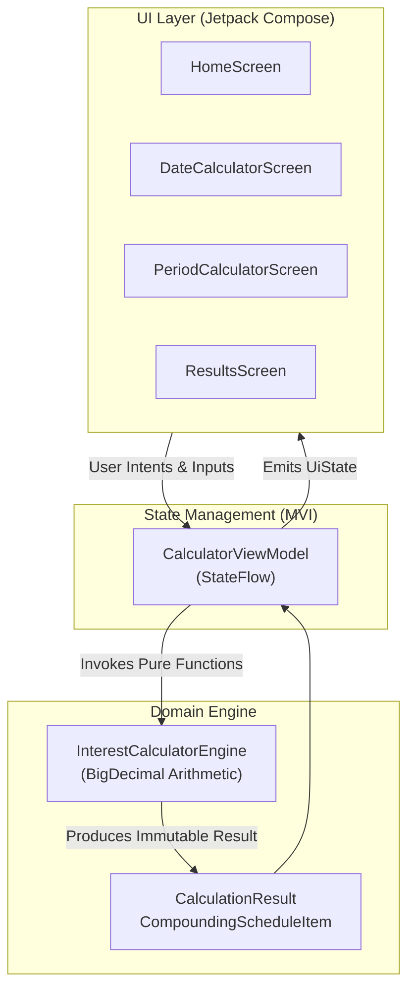

# Interest Calculator 📈

<p align="center">
  
  
  
  
  
  
  
</p>

A precision-engineered, production-ready, 100% offline financial calculator designed specifically for **peer-to-peer lending**, **micro-finance contracts**, and **promissory agreements**. Built natively for Android using **Kotlin**, **Jetpack Compose**, and **Material Design 3**, accompanied by a synchronized, responsive web application.

---

## 📑 Table of Contents

- [Overview & Problem Statement](#-overview--problem-statement)
- [Calculation Modes](#-calculation-modes)
  - [1. Simple Interest (Days to Months Conversion)](#1-simple-interest-days-to-months-conversion)
  - [2. Compound Interest (Annual Compounding)](#2-compound-interest-annual-compounding)
  - [3. Special Time Period (Loan Agreement vs. Actual Paytime)](#3-special-time-period-loan-agreement-vs-actual-paytime)
- [Mathematical Engine & Precision](#-mathematical-engine--precision)
- [Architecture & Tech Stack](#-architecture--tech-stack)
- [Automated Verification & Test Suite](#-automated-verification--test-suite)
- [Project Structure](#-project-structure)
- [Building & Installation](#-building--installation)
- [Downloads & Releases](#-downloads--releases)
- [License](#-license)

---

## 💡 Overview & Problem Statement

In informal and regional lending practices (such as promissory notes, agricultural credit, and private financing in India), interest is predominantly calculated on a **monthly frequency** (e.g., ₹2 per ₹100 per month = 2% per month) rather than a simple annual 365-day fraction. Furthermore, borrowers agree on a promised return duration (e.g., *"I will repay in 6 months"*), but actual repayments often occur earlier or later.

Standard banking calculators fail in these scenarios because:
1. They ignore month-based day-conversion standards ($30\text{ days} = 1\text{ month}$).
2. They do not distinguish between the **agreed loan duration** and the **actual paytime duration**.
3. They require internet connectivity and inject unsolicited advertisements.

**Interest Calculator** solves this with an enterprise-grade calculation engine, transparent formula auditing, offline-first security, and full Indian Rupee (`₹`) formatting.

---

## 🧮 Calculation Modes

### 1. Simple Interest (Days to Months Conversion)

Calculates linear non-compounding interest based on calendar dates:
- **Date Inputs**: Select Start Date (loan taken) and End Date (repayment date, defaults to current date).
- **Time Conversion**: Calendar days are accurately measured ($\text{End} - \text{Start}$) and converted into elapsed months:
  $$T_{\text{months}} = \text{Full Months} + \frac{\text{Remaining Days}}{30}$$
- **Formula**:
  $$\text{Simple Interest} = \frac{P \times T_{\text{months}} \times R}{100}$$
  $$\text{Total Amount} = P + \text{Simple Interest}$$
- **Rate Flexibility**: Toggle between **% per month** (standard informal lending) and **% per annum** (annual banking rate).

---

### 2. Compound Interest (Annual Compounding)

Calculates interest with annual compounding intervals and partial-month proportional accrual for remainders:
1. Initialize $\text{Current Balance} = P$.
2. For each complete 365-day year, compound the accrued interest into the balance:
   $$\text{Balance}_{k} = \text{Balance}_{k-1} \times \left(1 + \frac{R_{\text{annual}}}{100}\right)$$
3. For remaining days ($R_{\text{days}} < 365$), compute fractional month interest on the updated balance:
   $$T_{\text{rem}} = \left\lfloor\frac{R_{\text{days}}}{30}\right\rfloor + \frac{R_{\text{days}} \pmod{30}}{30}$$
   $$\text{Interest}_{\text{rem}} = \frac{\text{Balance}_{\text{final}} \times T_{\text{rem}} \times R_{\text{rate}}}{100}$$
4. Final balance:
   $$\text{Total Amount} = P + \text{Total Interest}$$
- An interactive **Annual Compounding Schedule** displays the year-by-year opening balance, earned interest, and closing balance.

---

### 3. Special Time Period (Loan Agreement vs. Actual Paytime)

Engineered for real-world peer-to-peer loan agreements:

```
[Borrow Date] ──────── Agreed Duration (Y/M/D) ────────> [Promised Due Date]
      │
      └────────────── Elapsed Paytime Duration ──────────────> [Paying Date]
                                                                     │
                                             ┌───────────────────────┴───────────────────────┐
                                             ▼                                               ▼
                                  Paid Early / On-Time                            Overdue / Delayed
                                  (Full Paytime Interest)                         (Agreed Interest + Overdue Delay Interest)
```

1. **Initial Agreement**:
   - The user inputs the **Borrow Date** and the duration the borrower promised to return the money (Years, Months, Days).
   - The engine computes the **Promised Return Date (Due Date)**:
     $$D_{\text{due}} = D_{\text{borrow}} + \text{Agreed Duration}$$
2. **Actual Paytime Duration**:
   - The user selects the **Paying Date** (or checks **"Repaid Today"**).
   - The engine computes the total elapsed calendar days between Borrow Date and Paying Date:
     $$T_{\text{paytime}} = \text{Full Months} + \frac{\text{Remaining Days}}{30}$$
3. **Settlement & Overdue Analysis**:
   - **On-Time / Paid Early**: If paid on or before the promised due date, standard simple interest applies to the elapsed paytime:
     $$\text{Total Amount} = P + \frac{P \times T_{\text{paytime}} \times R}{100}$$
     Displays **Actual Amount on Due Date** alongside early settlement savings.
   - **Overdue / Time Exceeded (Compounding Rule)**: At the promised due date, the **Principal and Agreed Interest are combined** into a new base balance (compounded):
     $$P_{\text{combined}} = P + \text{Agreed Interest} = P + \frac{P \times T_{\text{agreed}} \times R}{100}$$
     For the overdue duration ($T_{\text{overdue}}$ from promised return date to actual repayment date), interest is calculated on this combined principal:
     $$\text{Overdue Delay Interest} = \frac{P_{\text{combined}} \times T_{\text{overdue}} \times R}{100}$$
     $$\text{Amount After Overdue Date} = P_{\text{combined}} + \text{Overdue Delay Interest}$$
   - The results screen details:
     - **Actual Amount (on Due Date)**: What was originally due on the promised date ($P + I_{\text{agreed}}$).
     - **Amount After Overdue Date**: Total payable amount incorporating the compounded delay interest.
     - **Combined Overdue Principal**: Base balance upon which overdue interest accrued.
     - **Overdue Delay Interest**: Interest accumulated strictly during the delay period.

---

## ⚙️ Mathematical Engine & Precision

- **Zero Floating-Point Drift**: All calculations utilize Java's `BigDecimal` with `MathContext.DECIMAL128`. Financial results are rounded to two decimal places using `RoundingMode.HALF_UP`.
- **Guaranteed Balance Invariant**:
  $$\text{Total Amount} \equiv \text{Principal} + \text{Total Interest}$$
- **Indian Numbering System**: Formatted with standard Indian grouping (e.g., `₹10,000.00`, `₹1,00,000.00`, `₹12,34,567.89`).

---

## 🏛️ Architecture & Tech Stack



| Layer | Technologies |
|:---|:---|
| **Architecture** | Clean Architecture, MVI (Model-View-Intent), Unidirectional Data Flow |
| **Framework** | Android Jetpack (Compose BOM 2024.02.00, Material Design 3) |
| **Language** | Kotlin 1.9.0 |
| **Concurrency** | Kotlin Coroutines & StateFlow |
| **Testing** | JUnit 4, Kotlin Test |
| **Security** | 100% Offline, Zero permissions requested in `AndroidManifest.xml` |

---

## 🧪 Automated Verification & Test Suite

The test suite in [`InterestCalculatorEngineTest.kt`](file:///d:/Cal/app/src/test/java/com/interestcalculator/app/InterestCalculatorEngineTest.kt) validates 19 scenarios covering mathematical edge cases, leap years, user formulas, and agreement statuses:

| # | Scenario Tested | Input | Expected Output | Status |
|:---:|:---|:---|:---|:---:|
| 1 | Zero-day duration | 0 days | Interest = ₹0.00, Total = Principal | ✅ Passed |
| 2 | Simple interest for 365 days | ₹10,000 @ 12% | Month-converted interest | ✅ Passed |
| 3 | Simple interest for 730 days | ₹10,000 @ 12% | Non-compounding monthly calculation | ✅ Passed |
| 4 | Compound interest for 365 days | ₹10,000 @ 12% | 1 Year compounding | ✅ Passed |
| 5 | Compound interest for 400 days | ₹10,000 @ 12% | 1 Year + remainder month calculation | ✅ Passed |
| 6 | Compound interest for 730 days | ₹10,000 @ 12% | 2 Years annual compounding | ✅ Passed |
| 7 | Zero interest rate | 0% rate | Interest = ₹0.00 | ✅ Passed |
| 8 | One-day duration | ₹36,500 @ 10% | Fractional month interest | ✅ Passed |
| 9 | End date equal to start date | Date = Date | 0 days duration | ✅ Passed |
| 10 | Invalid date range | End < Start | Throws `IllegalArgumentException` | ✅ Passed |
| 11 | Specified period 45 days | 45 days | 1 month 15 days = 1.5 months | ✅ Passed |
| 12 | Specified period 6 months | 6 months | 6.0 months | ✅ Passed |
| 13 | Specified period 2 years | 2 years | 24.0 months | ✅ Passed |
| 14 | Very large principal & rate | ₹100T @ 50% | Safe `BigDecimal` math without overflow | ✅ Passed |
| 15 | Displayed total equation | Arbitrary values | $\text{Total} \equiv P + \text{Interest}$ strictly holds | ✅ Passed |
| 16 | User Formula Simple Interest | ₹1,00,000, 12 mo, 2% | Exactly ₹24,000.00 | ✅ Passed |
| 17 | User Formula Partial Month | ₹50,000, 6.5 mo, 1.5% | Exactly ₹4,875.00 | ✅ Passed |
| 18 | Special Period (Overdue) | 6 mo agreed, paid at 8 mo 3 d | Overdue: P + I combined at due date, compounded overdue interest | ✅ Passed |
| 19 | Special Period (Paid Early) | 6 mo agreed, paid at 4 mo | Paid early: Actual due amount ₹11,200, settled at ₹10,800 | ✅ Passed |

To run the test suite:
```bash
./gradlew test
```

---

## 📂 Project Structure

```
d:/Cal/
├── .github/
│   └── workflows/
│       └── android.yml                # Automated CI pipeline (Build & Unit Tests)
├── app/
│   ├── src/
│   │   ├── main/
│   │   │   ├── java/com/interestcalculator/app/
│   │   │   │   ├── MainActivity.kt    # Root Compose activity & navigation
│   │   │   │   ├── data/
│   │   │   │   │   ├── CalculationMode.kt
│   │   │   │   │   └── CalculationResult.kt
│   │   │   │   ├── engine/
│   │   │   │   │   └── InterestCalculatorEngine.kt
│   │   │   │   ├── ui/
│   │   │   │   │   ├── screens/
│   │   │   │   │   │   ├── HomeScreen.kt
│   │   │   │   │   │   ├── DateCalculatorScreen.kt
│   │   │   │   │   │   ├── PeriodCalculatorScreen.kt
│   │   │   │   │   │   └── ResultsScreen.kt
│   │   │   │   │   └── theme/
│   │   │   │   └── viewmodel/
│   │   │   │       └── CalculatorViewModel.kt
│   │   │   └── AndroidManifest.xml
│   │   └── test/java/com/interestcalculator/app/
│   │       └── InterestCalculatorEngineTest.kt
│   └── build.gradle.kts
├── index.html                         # Standalone companion web application
├── InterestCalculator-release.apk     # Production signed APK
├── InterestCalculator-release.aab     # Google Play Store bundle
├── build_apk.bat                      # 1-Click Windows build script
├── CONTRIBUTING.md                    # Open-source contribution guidelines
├── LICENSE                            # MIT License
└── README.md                          # Repository documentation
```

---

## 🔨 Building & Installation

### Prerequisites
- Java Development Kit (JDK) 17+
- Android SDK 34 (Android 14)

### Command-Line Build
```powershell
# Set JDK 17 environment
$env:JAVA_HOME="d:\tools\jdk-17.0.10+7"
$env:PATH="d:\tools\jdk-17.0.10+7\bin;$env:PATH"

# Run tests and build signed APK & AAB
.\gradlew.bat test assembleRelease bundleRelease
```

### One-Click Windows Script
Double-click `build_apk.bat` in the project root to automatically build and copy the latest APK.

---

## 📦 Downloads & Releases

- **Direct Release APK**: [`InterestCalculator-release.apk`](file:///d:/Cal/InterestCalculator-release.apk)
- **Google Play App Bundle**: [`InterestCalculator-release.aab`](file:///d:/Cal/InterestCalculator-release.aab)
- **GitHub Repository**: [himasagardega-commits/IntrestCalculator](https://github.com/himasagardega-commits/IntrestCalculator.git)

---

## 📄 License

This project is open-source software licensed under the [MIT License](LICENSE).
